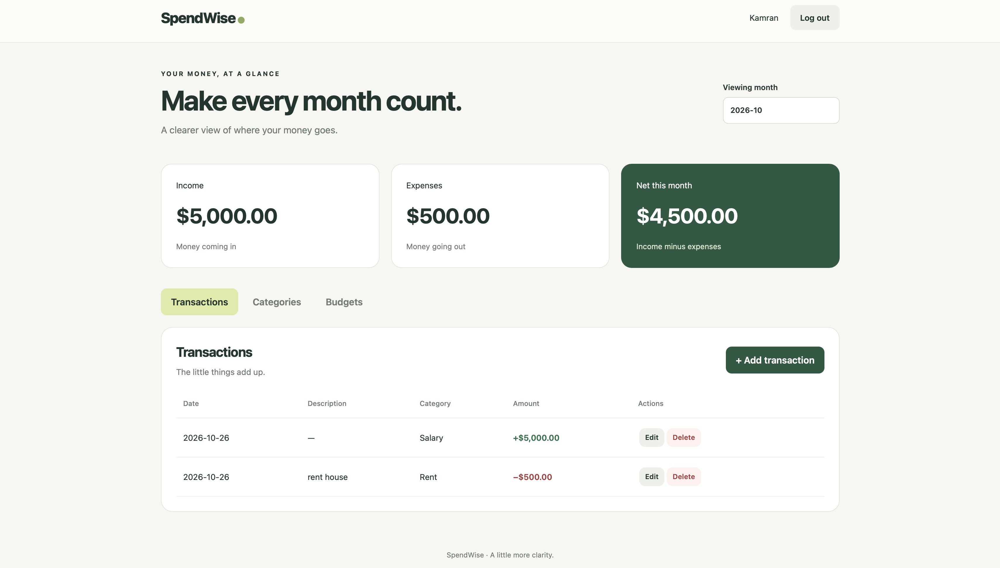

# SpendWise

A personal finance application built with FastAPI, SQLAlchemy, and vanilla JavaScript. Users can track income and expenses, organize transactions into categories, and monitor monthly budgets.

## Preview



## Features

- User registration and login
- Argon2 password hashing and expiring JWT access tokens
- Ownership checks for transactions, categories, and budgets
- Create, view, edit, and delete financial records
- Monthly income, expense, and net totals
- Budget progress and remaining amounts
- Transaction filtering and pagination through the API
- Responsive frontend and interactive API documentation

## Technology

- Python
- FastAPI
- SQLAlchemy
- SQLite
- Pydantic
- PyJWT and pwdlib
- HTML, CSS, and JavaScript

## Run locally

Use Python 3.14, the version used during development.

### 1. Set up the environment

From the project directory:

```bash
python3 -m venv .venv
source .venv/bin/activate
python -m pip install -r requirements.txt
```

On Windows, activate the environment with:

```powershell
.venv\Scripts\Activate.ps1
```

### 2. Configure the secret key

Generate a random key:

```bash
python -c "import secrets; print(secrets.token_hex(32))"
```

Create a `.env` file in the project directory:

```dotenv
SECRET_KEY=replace_with_your_generated_key
```

Keep `.env` private and excluded from Git.

### 3. Initialize the database

```bash
python create_tables.py
```

### 4. Start the application

```bash
uvicorn main:app --reload --port 8001
```

- Application: http://127.0.0.1:8001
- API documentation: http://127.0.0.1:8001/docs

Register an account through the application. Passwords must contain 15–128 characters.

The local database starts empty. Create categories before adding transactions. Budgets require an expense category.

## Project files

| File | Purpose |
| --- | --- |
| `main.py` | API routes, authentication checks, and frontend serving |
| `models.py` | Database models |
| `schemas.py` | Request validation and response schemas |
| `database.py` | Database connection and session dependency |
| `security.py` | Password hashing and token generation |
| `create_tables.py` | Database table initialization |
| `static/index.html` | Application interface |
| `static/styles.css` | Styling and responsive layout |
| `static/app.js` | Frontend behavior and API requests |

## API overview

| Method | Endpoint | Purpose |
| --- | --- | --- |
| POST | `/auth/register` | Register |
| POST | `/auth/login` | Obtain an access token |
| GET | `/auth/me` | View the current user |
| GET, POST | `/transactions` | List or create transactions |
| GET, PATCH, DELETE | `/transactions/{id}` | Manage a transaction |
| GET, POST | `/categories` | List or create categories |
| GET, PATCH, DELETE | `/categories/{id}` | Manage a category |
| GET, POST | `/budgets` | List or create budgets |
| GET, PATCH, DELETE | `/budgets/{id}` | Manage a budget |
| GET | `/budgets/{id}/summary` | View spending and remaining budget |

Financial routes require a bearer token. Records belonging to another user return 404.

## Current scope

This is a local portfolio project. Access tokens expire after 30 minutes; automatic refresh is not implemented. The interface displays amounts in USD, without currency conversion.

SQLite stores data locally in `spendwise.db`. The database and secret configuration are excluded from the repository.